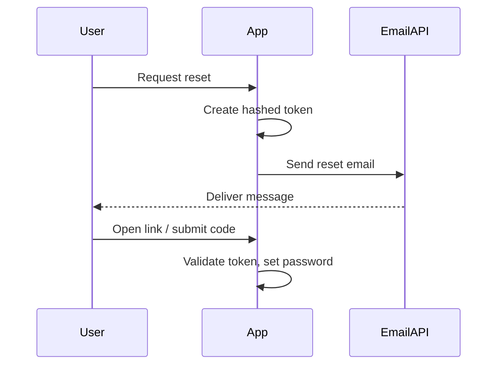

# Password reset

## When to send

User requests a reset. Email contains a **short-lived, single-use** link or code.

## Sequence



## Security

- Store only hashes of tokens; expire quickly
- Don’t reveal whether the email exists (generic response)
- HTTPS only on reset URLs

## Sample HTML

```html
<p>Reset your password:</p>
<p><a href="{{RESET_URL}}">{{RESET_URL}}</a></p>
<p>If you didn’t ask for this, ignore this email.</p>
```

## Kits / docs

- https://github.com/email-examples/transactional-email-examples/tree/main/nextjs-password-reset
- https://notify.cx/docs/how-to-send-password-reset-emails
